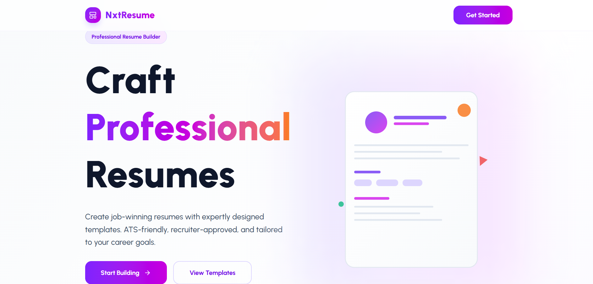
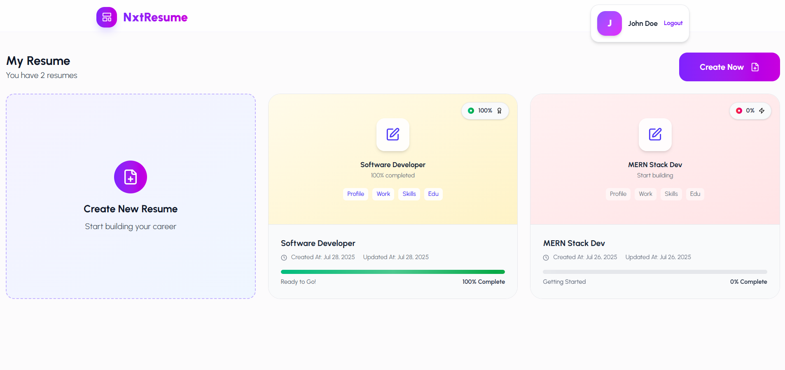
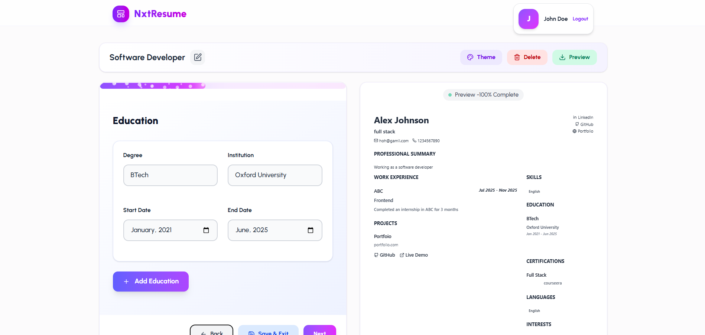
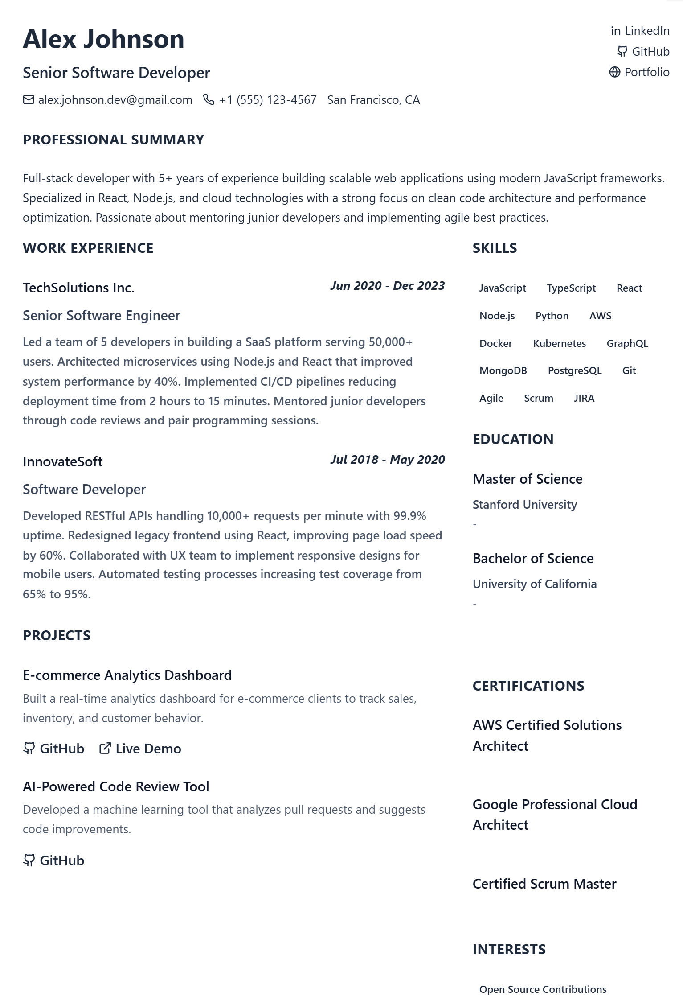

# NxtResume - MERN Resume Builder 🚀

NxtResume is a full-stack resume builder web application built using the **MERN** stack (MongoDB, Express.js, React.js, Node.js) with a clean and responsive UI powered by **Tailwind CSS**. Users can create, manage, and export multiple resumes with ease.

---

## 🌐 Live Demo

Check out the live version of the app:  
🔗 [NxtResume Live](https://nxtresume-frontend.onrender.com/)

---

## 🌟 Features

- 📄 **Create and manage multiple resumes**
- 🎨 **Modern responsive UI with Tailwind CSS**
- 📦 **Backend API with Express and Node.js**
- 🧾 **MongoDB schema for resume storage**
- 🖨️ **PDF Export Functionality**
- 📱 **Mobile-optimized and responsive**
- 📊 **Visual progress tracking**


---

## 🛠️ Tech Stack

- **Frontend:** React.js, Tailwind CSS, Vite
- **Backend:** Node.js, Express.js
- **Database:** MongoDB Atlas
- **Deployment:** Render.com (Frontend + Backend)

---


## 📦 Installation (Local Setup)

```bash
# Clone the repository
git clone https://github.com/PrajwalWadekar/nxtresume.git
cd nxtresume

# Install backend dependencies
cd backend
npm install

# Start backend server
npm run dev

# In a new terminal, go to frontend
cd ../frontend
npm install

# Start frontend
npm run dev
```

---

## 🌐 Live Link

👉 [https://nxtresume.site/](https://nxtresume-frontend.onrender.com/)

---

## 🖼️ Screenshots

### 🏠 Home Page


### 📝Dashboard Page


### 📄 Resume Preview


### 📄 Resume 


---

